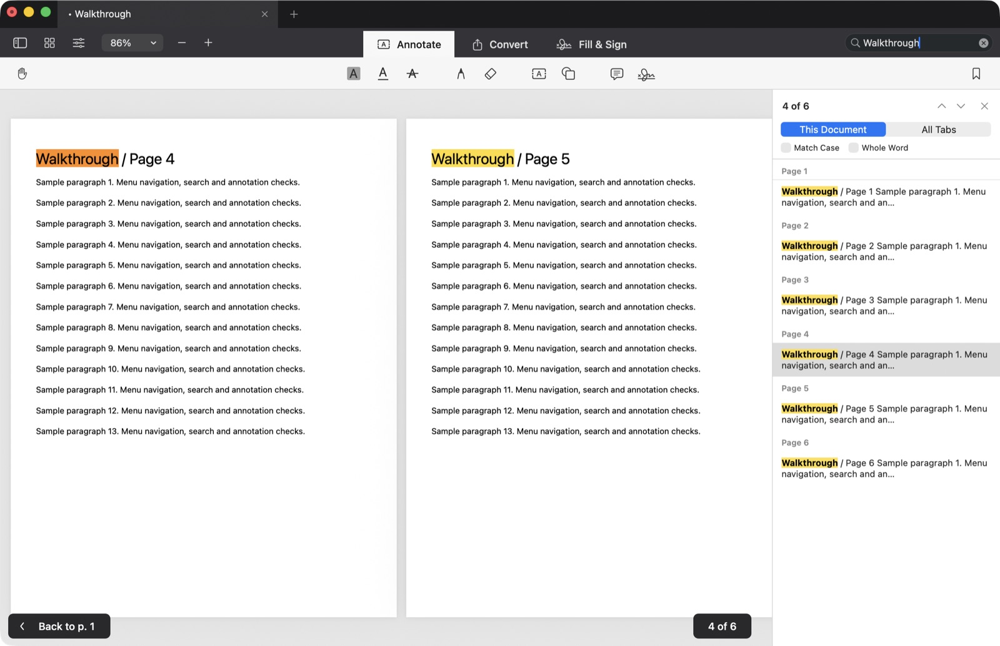

# PdfPuffin: an open-source PDF Expert alternative for macOS

PdfPuffin is a free, open-source PDF reader and editor for the Mac, modelled on PDF Expert. It is a native macOS app built with Swift, AppKit and PDFKit. Annotate and highlight PDFs, fill and sign forms, run OCR on scans, extract and reorder pages, compare documents side by side, export to Word, and export your notes to Markdown.

If you use PDF Expert on the Mac, PdfPuffin’s menus, keyboard shortcuts, and annotation tools should feel familiar. It can import the signatures you saved in PDF Expert. Select ten pages from a casebook to make a class excerpt, compare two drafts side by side, or export your highlights as Markdown.



`docs/reference/read-menus.applescript` dumps PDF Expert's menus and shortcuts, which PdfPuffin's menus follow.

## Run it

```bash
./run.sh                       # build (release) and open
./run.sh ~/Downloads/some.pdf  # build and open files
./run.sh --debug               # debug build
./run.sh --stop                # quit the running copy
```

The build makes a real app bundle, `build/PdfPuffin.app` (ad-hoc signed, registered
for PDFs and images). You can double-click it, keep it in the Dock, or pick it in
Finder ▸ Get Info ▸ Open with. It is **not** copied to /Applications; do that by hand
if you want it there.

Requirements: Command Line Tools with Swift 6 (no Xcode). Build only: `scripts/build.sh [release|debug]`.

## Make an excerpt

Click a thumbnail, then Shift-click the last page of a range or Command-click individual pages.
Press ⌘C, ⌘N, then ⌘S. PdfPuffin suggests a name such as
`Goldberg (pages 41–50).pdf` and keeps the selected pages in document order.
File ▸ New ▸ From Selected Pages creates the same excerpt directly.

For a typed range, choose **File ▸ New ▸ From Page Range…**. Enter a range such as
`41–50, 63–65` and check the count and endpoint thumbnails. Ranges are combined in
document order. Select **Printed pages** to use PDF page labels. For a scan, go to
a known page and use **Go ▸ Set Printed Page Number…** to set the numbering offset
for that file on this Mac. **Go to Page…** supports the same numbering choices.

Drag thumbnails to reorder pages. Right-click a thumbnail selection and choose
**Remove Page** or **Remove N Pages**. Both operations support Undo and Redo;
one page must remain. Save the excerpt to keep your edits.

## Prepare a reading packet

Choose **File ▸ Merge Files…**, add PDFs or open tabs (including an unsaved excerpt),
and arrange them with **Up** and **Down**. Edit each section title, then choose
**Create Packet**. The new tab opens with a clickable outline entry for the first
page of each section. Use **⌘S** to save the packet.

**File ▸ Save Copy Without Annotations…** writes a separate PDF from the current
tab, including its unsaved page edits. It removes PDF annotations, including notes,
highlights, link annotations, and form widgets. Page content, including markup
already flattened into a page, stays visible. The teaching copy keeps its edits.
The packet’s outline works in the student copy.

## Compare passages and export reading notes

Use **View ▸ Split View ▸ Horizontal** or **Vertical** to open a second view of the
same PDF. Scroll either pane independently. Click a pane to direct page jumps,
keyboard navigation, search results, and zoom to it. The active pane has an
accent border. **Disable Split View** keeps the active pane.

Open two PDF tabs and choose **View ▸ Split View ▸ Compare Open Documents…**.
Choose a tab above each pane, align the passages, then enable **Sync Scroll and Zoom**
to keep that offset as you read. **Swap Sides** exchanges the panes. **Done** returns
to your tab. The comparison uses snapshots including unsaved edits.

The **View Settings** button next to the thumbnail grid button groups page layout,
continuous scrolling, split direction, and document comparison.

Use **File ▸ Export Reading Notes ▸ Copy as Markdown** or **Save as Markdown…**.
The same commands are in the annotation list’s context menu. Notes are grouped
by printed page, with the physical PDF page included when it differs. Markup
exports the selected passage and any distinct annotation comment. Text notes
include their contents; drawings without text are omitted.

## Crop pages

Choose **Annotate ▸ Crop Pages…** or **Crop** in the page grid. Drag a rectangle
around the area to keep in the preview. Apply it to the current page, the selected
thumbnails, or all pages. Mixed-size pages keep the same proportional margins in
their displayed orientation. One Undo restores the whole batch. Cropping changes
the PDF crop box, so content outside the visible area remains in the file.

## Page grid

**View ▸ Thumbnails** (⌘4) or the four-squares button next to the sidebar button
shows every page as a thumbnail, like PDF Expert. The annotate bar becomes the page
tools: **Insert page** (blank, after the selection), **Append file** (a PDF's pages
after the selection), **Rotate** (⌥-click turns the other way), **Copy**, **Paste**
(PDF pages or images after the selection), **Extract** (selected pages as a new tab)
and **Delete**. Click, ⌘-click and ⇧-click select; drag pages to reorder; arrow keys
move through the grid (⇧ extends); Return or double-click opens a page; Esc or ⌘4
goes back to reading. Every change can be undone.

## Features

- **Tabs** in a dark tab strip: one document per tab, Home tab (Open Files,
  drop zone, New from Clipboard, Recents grid), ⌘T, ⌘W, ⌃Tab / ⌃⇧Tab, ⇧⌘[ / ⇧⌘].
  Unsaved tabs show a dot and ask before closing or quitting.
- **Paging:** Single Page, Two Pages, Two Pages but First Single, with or without
  Continuous Scroll; zoom box (percentages, Fit Width, Fit Page, Automatic) with − / +;
  floating "N of M" badge (click it for Go to Page); "‹ Back to p. N" pill after a jump.
  Reopens each file at the page you left it.
- **Left sidebar** with PDF Expert's four tabs: Bookmarks (⌘D, saved per file),
  Outline, Annotations, Thumbnails (page numbers; blue badge on the current page).
- **Thumbnail selection and merge:** click, ⌘-click, ⇧-click. With 2+ pages
  selected the panel shows *New Document* and *Add to…* (another open tab).
  Right-click for the same, plus Select All / Deselect. ⌘C copies the selected
  pages as a PDF.
- **New from Clipboard** (File ▸ New ▸ From Clipboard, ⌘N): PDF data, copied PDF or
  image files, or an image/screenshot become a new tab. Greyed out when the clipboard
  holds nothing usable. Also `PdfPuffin --from-clipboard` at launch.
- **Search panel** on the right: "Found: N", results grouped by page with the match
  in context, ↑ / ↓ arrows, This Document / All Tabs. Return or ⌘G = next, ⇧⌘G =
  previous, Esc closes.
- **Annotate bar like PDF Expert's:** A-highlight, A-underline, A-strikeout | Pen, Eraser |
  Text, Shapes | Note, Signature. Arming a tool opens a right-hand inspector, as in PDF
  Expert, with that tool's colour swatches, line width, opacity, and fill (shapes), or
  font, size, bold, italic, text colour and background (Text). Each tool remembers its
  own settings. Esc or the hand button puts the tool down.
  - **Text:** click anywhere on the page and type directly; click elsewhere or Esc to
    finish; double-click a text box to edit it. Use it on lines that are not form fields.
  - **Form fields:** fillable fields take typing directly with the hand tool.
  - **Shapes:** rectangle, oval, line, arrow, highlight area; drag to draw, ⇧ for a
    square / circle / straight line.
  - **Pen** draws freehand; **Eraser** removes whole annotations you click or drag over.
  - **Signature:** shows your signatures (imported from PDF Expert's saved signatures the
    first time; *Import from PDF Expert* re-checks, *Add Image of Signature…* adds one).
    Pick one, then click the page to place it at its usual size or drag a box to size it.
  - **Move / resize / delete:** with no tool armed, click a placed signature, shape,
    pen stroke, text box or note to select it (dashed box with handles). Drag to move,
    drag a corner to resize (signatures keep their proportions), Delete removes it.
  - **Undo / Redo** (⌘Z / ⇧⌘Z), kept per tab: markup, notes, text boxes, shapes, pen,
    signatures, moves and resizes, erasing and deleting, page rotation, appended,
    moved and removed pages.
  - Everything is saved into the PDF with its own appearance, so Preview, Acrobat and
    PDF Expert show it (checked with Quick Look on a signed test form).
- **Convert** tab (or File ▸ Export To): **to Word** writes a .docx with the text,
  fonts and sizes, rejoins wrapped lines into paragraphs, undoes end-of-line hyphens,
  and starts each PDF page on a new Word page. **to Text / to RTF / to HTML** use the
  same reflowed text. **to Image** saves each page (with annotations) as a 144-dpi PNG
  into a folder you pick. Images and drawings are not carried into the text formats.
- **Fill & Sign** tab: Text, Signature, **Date** (today's date as an editable text box;
  format in the right panel), **Checkmark**, **Cross**, **Stamp** (Approved, Reviewed,
  Received, Draft, Final, Confidential, Not Approved, Void, Copy, optionally dated).
  Click to place; select to move or resize; colours per tool. They save with their own
  appearance, so other PDF readers show them. **Export as Flattened** (also File ▸
  Save as Flattened…) writes a copy with every annotation, signature and form entry
  burned into the page.
- **Scan & OCR ▸ Recognize Text:** reads pages that have no text layer with Apple's
  Vision text recognizer (about half a second a page) and lays the words over the page
  as invisible text, so scans search, highlight, copy and convert to Word. Pages that
  already have text are left alone; notes and highlights on a page carry over; Undo
  reverts it. The original page is drawn unchanged, but scans stored as JBIG2 are
  re-encoded (macOS can't write JBIG2), so the file can grow: a 5-page patent scan
  went from 442 KB to 1.0 MB. Reduce File Size can bring it back down.
- **File ▸ Reduce File Size…** saves a copy with images recompressed as JPEG at screen
  resolution (shows before → after; saves nothing if it wouldn't be smaller).
  **Set Password…** saves a password-protected copy. **Properties…** shows file,
  page size, PDF version, title, author, dates, producer, security and whether the
  pages have a text layer.
- **Save / Save As** (refuses to Save As onto a file open in another tab), Print,
  Rotate current page (⌘L / ⌘R), Show in Finder.

## Keyboard

| Keys | Action |
|---|---|
| ← / → | previous / next page (always, even right after clicking a thumbnail or button) |
| ↑ / ↓ | scroll; **after clicking a thumbnail**, previous / next page (click the page to go back to scrolling) |
| Space / ⇧Space, Page Down / Page Up | page down / up |
| Home / End | first / last page |
| ⌥↑ / ⌥↓ | previous / next page (PDF Expert's Go menu) |
| ⌥⌘G | Go to Page… (note: apps such as Google Drive can grab ⌥⌘G system-wide; click the "N of M" badge instead) |
| ⌘[ / ⌘] | back / forward in page history |
| ⌘1 / ⌘2 / ⌘3 | Single Page / Two Pages / Two Pages but First Single |
| ⌘4 | page grid (Thumbnails); ⌘4 again or the sidebar button leaves it |
| ⌥⌘1–4, ⌥⌘0 | Bookmarks / Outline / Annotations / Thumbnails panel, hide left panel |
| ⌘+ (⌘=) / ⌘− / ⌘0 / ⌘9 / ⌘8 | zoom in / out / 100% / fit width / fit page |
| ⌘F, ⌘G, ⇧⌘G, ⌘E | find, next, previous, use selection |
| ⌘D | add / remove bookmark |
| ⌃⌘H / ⌃⌘U / ⌃⌘S / ⌃⌘N | highlight / underline / strikeout / note |
| ⌃⌘T / ⌃⌘P / ⌃⌘E | text / pen / eraser |
| ⌃⌘R / ⌃⌘O / ⌃⌘L / ⌃⌘A | rectangle / oval / line / arrow |
| ⌃⌥⌘1–7 | colour for the current tool |
| Esc | put the tool down, finish typing, or deselect |
| Delete | remove the selected annotation |
| ⌘C | copy text, or copy selected thumbnail pages as a PDF |
| ⌘N | New from Clipboard (PdfPuffin's own; PDF Expert has no shortcut) |
| ⌘T, ⌘W, ⌥⌘W, ⇧⌘W | new tab, close tab, close other tabs, close window |
| ⌃Tab / ⌃⇧Tab, ⇧⌘] / ⇧⌘[ | next / previous tab |
| ⌘S, ⇧⌘S, ⌘P, ⌃⌘F | save, save as, print, full screen |

## Known gaps versus PDF Expert

- No Edit PDF, Excel / PowerPoint export, Measure, Translate, PDF Copilot or AI tools; Scan & OCR
  has only Recognize Text (no Enhance Scan, Split Pages, Clear Margins).
- No custom stamps, Content Selection, border styles / hatch patterns, pen
  sensitivity, or custom colour picker (seven fixed colours).
- Text boxes have one style for the whole box. You cannot draw a new signature in the app (import or add an image).
- No Day/Sepia/Night themes or editing embedded page labels.
- No File ▸ New ▸ Empty Document / From Images / From File.
- Search has Match Case and Whole Word, but no redaction.
- PDFKit rewrites the file on Save; complex PDFs may come out larger or slightly
  different from PDF Expert's saves.

## License

MIT. See [LICENSE](LICENSE).

## Disclaimer

PdfPuffin is an independent project. It is not affiliated with, endorsed by, or connected to Readdle, the maker of PDF Expert. PDF Expert is a trademark of its owner, used here only to describe compatibility and the design PdfPuffin follows.
